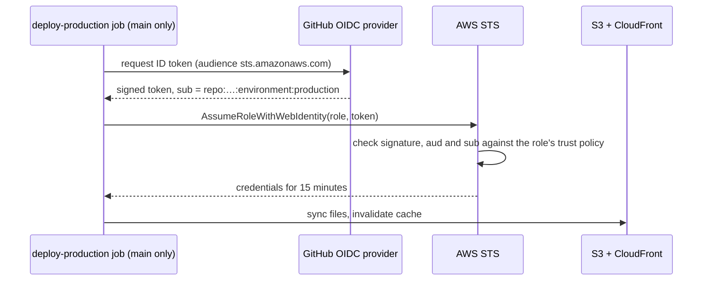

# 06 — Deploy pipeline: OIDC and automatic production deploys

## Goal

Merging a pull request into `main` deploys the site automatically. The deploy uses exactly the files CI built and tested in the same run. GitHub signs in to AWS with OIDC: short-lived credentials for one role, usable only by jobs in the GitHub `production` environment, which only `main` may use. No AWS keys are stored anywhere.

## Why it matters

- **No stored keys.** OIDC trust between GitHub and AWS, a least-privilege role and environment-scoped deploys are current best practice. Many teams still paste long-lived access keys into CI secrets, so doing this properly stands out.
- **Build once, deploy that.** The deploy job doesn't rebuild. It ships the artifact the `build` job checked (type-check, HTML validation, links, Lighthouse).
- **Easy rollback.** Revert and merge, or re-run an older deploy job (section H).

## How it works



The role's **trust policy** decides *who* may use it: only a token whose `sub` (subject) claim names this repo **and** the `production` environment. The role's **permission policy** decides *what* it may do: write to the site bucket and clear the site's CloudFront cache, nothing else.

## How this step works

Same as steps 04 and 05:
- You write the files and run every command that changes something: `terraform apply`, `gh api -X PUT/POST`, `gh variable set`, git.
- Claude runs `terraform plan` and checks it before each apply.
- `AWS_PROFILE=lumineglyph` must be **exported** in every terminal you use (`printenv AWS_PROFILE` should print it).

The order matters:
1. **A:** allow the AWS sign-in action in the repo's Actions settings.
2. **B:** create the `production` environment, so no job can create it by accident without its protection.
3. **C:** find the exact `sub` value with a throwaway PR, then restrict the environment to `main` and watch GitHub refuse that same PR (the negative test).
4. **D:** Terraform: the OIDC provider, the role and its permissions, using the `sub` from C.
5. **E:** the environment's variables (role ARN, bucket, distribution).
6. **F:** the deploy job in `pipeline.yml`.
7. **G:** PR and merge. The merge is the first automatic deploy.
8. **H:** rollback, including a harmless drill.

**What it costs:** nothing extra. IAM and OIDC are free. Each deploy makes one CloudFront invalidation of `/*`, which counts as one path; the first 1,000 paths a month are free.

## What Claude already checked (2026-11-21)

- **Actions allowlist.** The repo allows only GitHub-owned actions plus `lycheeverse/lychee-action@*`, with SHA pinning required. `aws-actions/configure-aws-credentials` isn't GitHub-owned, so without section A the deploy job fails before it starts.
- **`sub` format.** `GET /repos/lumineglyph/lumineglyph/actions/oidc/customization/sub` returns `use_immutable_subject: true` with prefix `repo:lumineglyph@356493958/lumineglyph@1460696603`. GitHub uses this newer format (owner and repo IDs, so a deleted and re-created repo with the same name can't match) for repos created after 2026-07-15; this one was created 2026-11-16. GitHub's docs only show it for branches, so the environment form is expected to be `repo:lumineglyph@356493958/lumineglyph@1460696603:environment:production`, and C confirms it.
- **AWS account.** `lumineglyph` has no OIDC providers yet, and no roles besides `OrganizationAccountAccessRole`.
- **GitHub environments.** The repo has none yet.
- **Provider schema** (AWS provider 6.73): `aws_iam_openid_connect_provider` needs only `url` and `client_id_list`; `thumbprint_list` is optional. AWS validates GitHub's certificate itself and ignores a thumbprint, and `configure-aws-credentials` says the same. Older tutorials that hard-code a thumbprint are out of date.
- **IAM.** CloudFront's `CreateInvalidation` and `GetInvalidation` can both be limited to one distribution ARN, so the role doesn't need `*`.
- **Actions**, each at least 7 days old (the same wait Dependabot uses):

  | Action | Version | Released | Commit |
  |---|---|---|---|
  | `actions/download-artifact` | v8.0.2 | 2026-10-07 | `9000827ccba6bdab643e8b6fd33ac0654aef8333` |
  | `aws-actions/configure-aws-credentials` | v6.3.0 | 2026-09-15 | `e1253824e5c10ff9df46874f81ed3ec929e19cfd` |

  `configure-aws-credentials` uses the audience `sts.amazonaws.com` and the regional STS endpoint by default. Its credentials last 1 hour unless `role-duration-seconds` says otherwise; F sets 15 minutes, the shortest AWS allows.
- **Re-runs.** GitHub allows re-running a job up to 30 days after the original run, with the same commit and ref. The build currently keeps its artifact for only 7 days, so F raises it to 30.

**Not checked yet:** whether the AWS CLI on the GitHub runner sets the same `Content-Type`s as your machine did in step 05 D (it guesses them from file extensions). The checkpoint confirms it after the first automatic deploy.

## Before you start

**1. Branch.** The new step file and the PROGRESS update go on it:
```sh
cd ~/code/ged/lumineglyph
git switch main && git pull
git switch -c rebuild/06-deploy-pipeline
git status            # docs/rebuild/06-deploy-pipeline.md and docs/rebuild/PROGRESS.md (modified)
git add docs/rebuild/06-deploy-pipeline.md docs/rebuild/PROGRESS.md
git commit -m "docs(rebuild): step 06 instructions"
```

**2. Log in:**
```sh
aws sso login --profile lumineglyph
export AWS_PROFILE=lumineglyph
aws sts get-caller-identity --query Account --output text   # 421803180949
gh auth status                                              # logged in as Ged-Miner
```

**3. Start from a clean plan:**
```sh
terraform -chdir=infra/main plan     # expect: No changes
```

### A. Allow the AWS sign-in action

`PUT` replaces the whole list, so it repeats the lychee entry:
```sh
gh api -X PUT repos/lumineglyph/lumineglyph/actions/permissions/selected-actions \
  -F github_owned_allowed=true \
  -F verified_allowed=false \
  -f 'patterns_allowed[]=lycheeverse/lychee-action@*' \
  -f 'patterns_allowed[]=aws-actions/configure-aws-credentials@*'

gh api repos/lumineglyph/lumineglyph/actions/permissions/selected-actions
```
- [ ] The second command prints `"github_owned_allowed":true`, `"verified_allowed":false` and both patterns.

The same setting in the browser: repo **Settings → Actions → General → Actions permissions**. The text box under "Allow specified actions and reusable workflows" should list both patterns. Leave "Require actions to be pinned to a full-length commit SHA" on.

### B. Create the `production` environment

```sh
gh api -X PUT repos/lumineglyph/lumineglyph/environments/production

gh api repos/lumineglyph/lumineglyph/environments/production \
  --jq '{name, deployment_branch_policy, protection_rules}'
```
- [ ] `"name":"production"`, `"deployment_branch_policy":null`, `"protection_rules":[]`.

No branch rule yet: C needs to run one job from a PR branch first. No AWS role trusts this environment yet, so there's nothing to misuse in the meantime.

**No required reviewers, on purpose.** Moena's merged edits should go live without waiting for you. The ruleset on `main` (PR plus the `build` check) is the gate.

### C. Find the exact `sub`, then restrict the environment to `main`

You'll open a throwaway PR whose only job asks GitHub for an OIDC token and prints its `sub` and `aud` claims. It never prints the token. The PR is never merged.

**1. A throwaway branch from `main`:**
```sh
git switch -c tmp/oidc-sub main
```

**2. Create `.github/workflows/oidc-sub-check.yml`:**
```yaml
# TEMPORARY (step 06 C). Prints the OIDC token's sub and aud claims for a job in the
# production environment. Never merged; the PR is closed and the branch deleted.
name: OIDC sub check (temporary)

on:
  pull_request:

permissions:
  contents: read

jobs:
  show-sub:
    runs-on: ubuntu-24.04
    timeout-minutes: 5
    environment: production
    permissions:
      id-token: write # request an OIDC token, to read its claims
    steps:
      # The runner gives every job with id-token: write a URL and a bearer token for requesting
      # an ID token. Only the decoded claims are printed, never the token itself.
      - name: Print the sub and aud claims
        run: |
          curl -sSf -H "Authorization: bearer $ACTIONS_ID_TOKEN_REQUEST_TOKEN" \
            "$ACTIONS_ID_TOKEN_REQUEST_URL&audience=sts.amazonaws.com" \
            | jq -r '.value' \
            | node -e '
                const token = require("fs").readFileSync(0, "utf8").trim();
                const claims = JSON.parse(Buffer.from(token.split(".")[1], "base64url"));
                console.log("sub=" + claims.sub);
                console.log("aud=" + claims.aud);
              '
```

**3. Commit, push and open a draft PR:**
```sh
git add .github/workflows/oidc-sub-check.yml
git commit -m "tmp: print the OIDC sub claim (do not merge)"
git push -u origin tmp/oidc-sub
gh pr create --draft --title "tmp: OIDC sub check (do not merge)" \
  --body "Temporary, for step 06 C. Closed without merging."
```

**4. Read the claims.** Wait about 10 seconds for the run to register:
```sh
RUN_ID=$(gh run list --workflow oidc-sub-check.yml --branch tmp/oidc-sub --limit 1 \
  --json databaseId --jq '.[0].databaseId')
echo "$RUN_ID"                              # a number; if empty, wait a few seconds and repeat
gh run watch "$RUN_ID" --exit-status
gh run view "$RUN_ID" --log | grep -E 'sub=repo:|aud=sts'
```
- [ ] The two lines end with:
```
sub=repo:lumineglyph@356493958/lumineglyph@1460696603:environment:production
aud=sts.amazonaws.com
```
If `sub` is different, stop and show Claude. D uses this exact value.

The repo's normal `Pipeline` also runs on this PR. Ignore it.

**5. Restrict the environment to `main`.** "Selected branches and tags", with one rule for the branch `main`:
```sh
gh api -X PUT repos/lumineglyph/lumineglyph/environments/production --input - <<'EOF'
{"deployment_branch_policy": {"protected_branches": false, "custom_branch_policies": true}}
EOF

gh api -X POST repos/lumineglyph/lumineglyph/environments/production/deployment-branch-policies \
  -f name=main -f type=branch

gh api repos/lumineglyph/lumineglyph/environments/production --jq '.deployment_branch_policy'
gh api repos/lumineglyph/lumineglyph/environments/production/deployment-branch-policies \
  --jq '.branch_policies[] | {name, type}'
```
- [ ] `{"custom_branch_policies":true,"protected_branches":false}` and `{"name":"main","type":"branch"}`.

In the browser: **Settings → Environments → production → Deployment branches and tags** shows "Selected branches and tags" with `main`.

**6. Negative test.** Re-run the same job. It's no longer on an allowed branch, so GitHub should refuse to start it:
```sh
gh run rerun "$RUN_ID"
sleep 15
gh run view "$RUN_ID"
```
- [ ] The job failed without running its step, with an annotation like `Branch "…" is not allowed to deploy to production due to environment protection rules.` Note the exact wording for PROGRESS.

From now on, even if a workflow on another branch asks for `production`, it gets no token for it.

**7. Clean up.** Switch back first, then close the PR and delete the branch (local and remote):
```sh
git switch rebuild/06-deploy-pipeline
gh pr close tmp/oidc-sub --delete-branch
git branch --list 'tmp/*'           # prints nothing
git ls-remote --heads origin tmp/oidc-sub   # prints nothing
```
The environment's history keeps one deployment from this PR. That's expected and harmless.

### D. OIDC provider and deploy role (Terraform)

**1. Create `infra/main/github-oidc.tf`.** If C printed a different `sub`, use that value in `locals`:
```hcl
# GitHub Actions signs in to AWS with OpenID Connect (OIDC). A job asks GitHub for a short-lived signed
# token, and AWS STS swaps it for temporary credentials of a role whose trust policy names this repo and
# environment. No AWS keys are stored in GitHub.

# Trust tokens issued by GitHub Actions. No thumbprint: AWS validates GitHub's certificate itself
# and ignores a thumbprint if one is given.
resource "aws_iam_openid_connect_provider" "github" {
  url            = "https://token.actions.githubusercontent.com"
  client_id_list = ["sts.amazonaws.com"]
}

locals {
  # The token's `sub` claim for jobs in the GitHub `production` environment, checked in step 06 C.
  # GitHub's immutable format includes the owner and repo IDs, so a deleted and re-created
  # repo with the same name can't produce it. Only `main` may use the environment (step 06 C.5).
  github_sub_production = "repo:lumineglyph@356493958/lumineglyph@1460696603:environment:production"
}

# Who may use the role: only a GitHub token meant for AWS, from this repo's production environment.
data "aws_iam_policy_document" "deploy_production_trust" {
  statement {
    sid     = "GitHubProductionEnvironment"
    effect  = "Allow"
    actions = ["sts:AssumeRoleWithWebIdentity"]

    principals {
      type        = "Federated"
      identifiers = [aws_iam_openid_connect_provider.github.arn]
    }

    condition {
      test     = "StringEquals"
      variable = "token.actions.githubusercontent.com:aud"
      values   = ["sts.amazonaws.com"]
    }

    # Exact match. A wildcard here (StringLike "repo:…:*") would let other branches, PRs or
    # environments in. That mistake is the usual way OIDC roles get misused.
    condition {
      test     = "StringEquals"
      variable = "token.actions.githubusercontent.com:sub"
      values   = [local.github_sub_production]
    }
  }
}

resource "aws_iam_role" "deploy_production" {
  name                 = "lumineglyph-deploy-production"
  description          = "GitHub Actions deploys of lumineglyph.com (production environment only)"
  assume_role_policy   = data.aws_iam_policy_document.deploy_production_trust.json
  max_session_duration = 3600 # the lowest maximum AWS allows; the job asks for 15 minutes
}

# What the role may do: sync files into the site bucket and clear the site's CloudFront cache.
# No s3:GetObject (sync compares against the bucket listing), and nothing on any other bucket or distribution.
data "aws_iam_policy_document" "deploy_production" {
  statement {
    sid       = "ListSiteBucket"
    actions   = ["s3:ListBucket"]
    resources = [aws_s3_bucket.site.arn]
  }

  statement {
    sid       = "WriteSiteObjects"
    actions   = ["s3:PutObject", "s3:DeleteObject"]
    resources = ["${aws_s3_bucket.site.arn}/*"]
  }

  statement {
    sid       = "InvalidateSiteCache"
    actions   = ["cloudfront:CreateInvalidation", "cloudfront:GetInvalidation"]
    resources = [aws_cloudfront_distribution.site.arn]
  }
}

resource "aws_iam_role_policy" "deploy_production" {
  name   = "deploy-site"
  role   = aws_iam_role.deploy_production.id
  policy = data.aws_iam_policy_document.deploy_production.json
}

output "deploy_production_role_arn" {
  value = aws_iam_role.deploy_production.arn
}
```

Why each permission:

| Action | Resource | Used by |
|---|---|---|
| `s3:ListBucket` | the site bucket | `aws s3 sync` lists the bucket to compare with `dist` |
| `s3:PutObject` | objects in the site bucket | uploading files |
| `s3:DeleteObject` | objects in the site bucket | `--delete` removing pages that no longer exist (versioning keeps them for 30 days) |
| `cloudfront:CreateInvalidation` | the site distribution | clearing the cache after a deploy |
| `cloudfront:GetInvalidation` | the site distribution | waiting until the clearing has finished |

**2. Plan:**
```sh
cd infra/main
terraform fmt
terraform validate
terraform plan -out=main.tfplan
```
- [ ] Tell Claude, and wait for the go-ahead. Claude checks for **3 to add**: the OIDC provider, the role and the role policy. Nothing should change or be destroyed.

```sh
terraform apply main.tfplan
rm main.tfplan
terraform plan                       # expect: No changes
terraform output deploy_production_role_arn
cd ../..
```
The ARN is `arn:aws:iam::421803180949:role/lumineglyph-deploy-production`. It isn't secret: without a matching GitHub token it's useless.

- [ ] Tell Claude. Claude runs the IAM policy simulator on the new role: the five actions above are allowed on the site bucket and distribution, and denied everywhere else.

**3. Commit:**
```sh
git add infra/main/github-oidc.tf
git commit -m "feat(infra): GitHub OIDC provider and production deploy role"
```

### E. Environment variables

These are **variables**, not secrets: none of them is sensitive, and variables show in logs, which helps debugging. From the repo root:
```sh
R=lumineglyph/lumineglyph
gh variable set AWS_REGION --env production --repo "$R" --body ap-northeast-1
gh variable set AWS_DEPLOY_ROLE_ARN --env production --repo "$R" \
  --body "$(terraform -chdir=infra/main output -raw deploy_production_role_arn)"
gh variable set SITE_BUCKET --env production --repo "$R" \
  --body "$(terraform -chdir=infra/main output -raw site_bucket)"
gh variable set SITE_DISTRIBUTION_ID --env production --repo "$R" \
  --body "$(terraform -chdir=infra/main output -raw site_distribution_id)"

gh variable list --env production --repo "$R"
```
- [ ] Four variables:

| Name | Value |
|---|---|
| `AWS_DEPLOY_ROLE_ARN` | `arn:aws:iam::421803180949:role/lumineglyph-deploy-production` |
| `AWS_REGION` | `ap-northeast-1` |
| `SITE_BUCKET` | `lumineglyph-site-732887` |
| `SITE_DISTRIBUTION_ID` | `E3EFRC3I100XWY` |

They're environment variables, so only jobs in `production` (that is, only `main`) can read them.

### F. The deploy job

Two changes to `.github/workflows/pipeline.yml`:
- The build keeps its artifact for **30 days** instead of 7. That's GitHub's limit for re-running a job, and the site bucket keeps old versions for 30 days too. Storage is free for public repos.
- A new `deploy-production` job after `build`.

**1. Replace the whole of `.github/workflows/pipeline.yml` with this.** Everything above the `upload-artifact` step is unchanged:
```yaml
name: Pipeline

on:
  pull_request:
  push:
    branches: [main]

# The default token for every job: read the repo, nothing else.
# Jobs that need more (the deploy jobs in steps 06 and 07) ask for it themselves.
permissions:
  contents: read

# A new push to a PR cancels that PR's older, still-running pipeline. Runs on main never cancel.
concurrency:
  group: pipeline-${{ github.ref }}
  cancel-in-progress: ${{ github.event_name == 'pull_request' }}

jobs:
  build:
    name: build # the name branch protection requires (step G)
    runs-on: ubuntu-24.04 # a fixed image rather than ubuntu-latest, so it doesn't change under us
    timeout-minutes: 15
    defaults:
      run:
        working-directory: site
    steps:
      - name: Check out the repo
        uses: actions/checkout@3d3c42e5aac5ba805825da76410c181273ba90b1 # v7.0.1
        with:
          persist-credentials: false # don't leave the token in .git/config for later steps

      - name: Set up Node
        uses: actions/setup-node@949feb2413d6458794dcd2491c4babbbce0c15c1 # v7.1.0
        with:
          node-version-file: site/.nvmrc
          cache: npm
          cache-dependency-path: site/package-lock.json

      - name: Install dependencies
        run: npm ci

      - name: Type-check
        run: npm run check

      - name: Build
        run: npm run build

      - name: Validate HTML
        run: npx html-validate "dist/**/*.html"

      # Internal links and #anchors only. --offline skips external sites, so another site
      # being down can't block a PR. --root-dir resolves links that start with "/".
      - name: Check internal links
        uses: lycheeverse/lychee-action@e7477775783ea5526144ba13e8db5eec57747ce8 # v2.9.0
        with:
          args: >-
            --offline
            --no-progress
            --include-fragments
            --index-files index.html
            --root-dir ${{ github.workspace }}/site/dist
            site/dist

      - name: Lighthouse
        run: npx lhci autorun

      - name: Upload the built site
        uses: actions/upload-artifact@cf430e030ddbb5b0abf93d22962f4752f3646cd9 # v7.0.2
        with:
          name: site-dist
          path: site/dist
          if-no-files-found: error
          # 30 days = how long GitHub lets you re-run a job, so an old deploy can be re-run (rollback).
          retention-days: 30

  # Deploys the artifact the build job just tested. Pushes to main only (merged PRs); skipped on PRs.
  deploy-production:
    name: deploy-production # rollback (step 06 H) looks the job up by this name
    if: github.event_name == 'push' && github.ref == 'refs/heads/main'
    needs: build
    runs-on: ubuntu-24.04
    timeout-minutes: 15
    # Only main may use this environment (deployment branch rule), and only this environment's
    # token can assume the AWS deploy role (trust policy in infra/main/github-oidc.tf).
    environment:
      name: production
      url: https://lumineglyph.com/
    permissions:
      id-token: write # request the OIDC token that AWS swaps for credentials; nothing else
    # One deploy at a time. A deploy in progress is never cancelled; a newer one waits.
    concurrency:
      group: deploy-production
      cancel-in-progress: false
    env:
      SITE_BUCKET: ${{ vars.SITE_BUCKET }}
      SITE_DISTRIBUTION_ID: ${{ vars.SITE_DISTRIBUTION_ID }}
    steps:
      - name: Download the built site
        uses: actions/download-artifact@9000827ccba6bdab643e8b6fd33ac0654aef8333 # v8.0.2
        with:
          name: site-dist
          path: dist

      # The sync below uses --delete. If the artifact's layout were ever wrong, it would delete
      # the live pages, so check that it looks like the site first.
      - name: Check the artifact
        run: |
          test -f dist/index.html
          test -f dist/en/index.html
          test -f dist/404.html
          test -d dist/_astro
          echo "$(find dist -type f | wc -l) files"

      - name: Sign in to AWS
        uses: aws-actions/configure-aws-credentials@e1253824e5c10ff9df46874f81ed3ec929e19cfd # v6.3.0
        with:
          role-to-assume: ${{ vars.AWS_DEPLOY_ROLE_ARN }}
          aws-region: ${{ vars.AWS_REGION }}
          role-duration-seconds: 900 # 15 minutes, the shortest AWS allows
          role-session-name: deploy-${{ github.run_id }} # shows in CloudTrail, traceable to this run

      # Hashed files first, then the pages that reference them, so a visitor never gets
      # a page pointing at files that aren't there yet. Old hashed files are kept (no --delete)
      # for visitors who still have an older page open.
      - name: Upload hashed assets
        run: >-
          aws s3 sync dist/_astro "s3://$SITE_BUCKET/_astro"
          --no-progress
          --cache-control "public, max-age=31536000, immutable"

      - name: Upload pages
        run: >-
          aws s3 sync dist "s3://$SITE_BUCKET"
          --no-progress
          --delete
          --exclude "_astro/*"
          --cache-control "public, max-age=0, s-maxage=31536000, must-revalidate"

      # CloudFront keeps pages until told otherwise (s-maxage). Clear everything and wait until
      # every edge location has, so a green job means the new version is live.
      - name: Clear the CDN cache
        run: |
          ID=$(aws cloudfront create-invalidation --distribution-id "$SITE_DISTRIBUTION_ID" \
            --paths "/*" --query Invalidation.Id --output text)
          echo "Invalidation $ID"
          aws cloudfront wait invalidation-completed --distribution-id "$SITE_DISTRIBUTION_ID" --id "$ID"
          echo "Done"
```

What's in it and why:
- **No checkout.** The deploy job doesn't need the source, only the artifact.
- **`permissions: id-token: write` only.** Setting job permissions turns every other permission off, so this job's GitHub token can't even read the repo. It doesn't need to.
- **`vars` go through `env:`** rather than straight into `run:` commands. That's the standard way to avoid script injection; the workflow scanner zizmor flags the other way.
- **Every deploy re-uploads every file.** The downloaded files are newer than the copies in S3, so `sync` sends them all. That's about 2 MB, a few seconds.
- **The wait** usually takes under a minute. AWS gives up after 10 minutes, which is why the job's timeout is 15.

**2. Check it locally** (optional, but quick). From the repo root:
```sh
uvx zizmor .github/workflows/
```
- [ ] `No findings to report.` If it reports something, show Claude.

**3. Commit:**
```sh
git add .github/workflows/pipeline.yml
git commit -m "ci: deploy main to production"
```

### G. Push, PR, merge: the first automatic deploy

**1. Push and open the PR:**
```sh
git push -u origin rebuild/06-deploy-pipeline
gh pr create --fill
gh pr checks --watch
```
- [ ] `build` passes. `deploy-production` shows as **skipped**: PRs never deploy to production.

Tell Claude. Claude reviews the PR (see "Claude reviews" in the checkpoint).

**2. Note the time, then merge.** The merge pushes to `main`, which runs the pipeline again: `build`, then `deploy-production`.
```sh
date -u +%Y-%m-%dT%H:%M:%SZ          # note this: the deploy must be newer
gh pr merge --merge --delete-branch
git switch main && git pull
```

**3. Watch the deploy:**
```sh
sleep 10
RUN_ID=$(gh run list --workflow pipeline.yml --branch main --event push --limit 1 \
  --json databaseId --jq '.[0].databaseId')
gh run watch "$RUN_ID" --exit-status
```
- [ ] Both jobs green. `build` takes a few minutes (Lighthouse), and `deploy-production` about 1–2.

**4. Quick look:**
```sh
curl -sI https://lumineglyph.com/ | grep -iE '^(HTTP|last-modified|x-cache)'
```
- [ ] `HTTP/2 200`, and `last-modified` is after the time you noted (it's in GMT, the same as UTC).

Also open the repo page on github.com: the right-hand column shows **Deployments → production**, with a link to the site.

Tell Claude, and give the run ID. Claude runs the checkpoint below.

### H. Rollback

There are two ways. Write both into the repo README in step 09.

**1. Revert the change (the normal way).** On a branch, revert the bad merge, open a PR and merge it. The pipeline builds and deploys the reverted code like any other change.
```sh
git switch main && git pull
git switch -c revert/<short-name>
git revert -m 1 <merge commit SHA>     # -m 1: keep main's side of the merge
git push -u origin revert/<short-name>
gh pr create --fill
```

**2. Re-run an older deploy (the fast way, about a minute).** Re-running a `deploy-production` job deploys that run's artifact again, without building.
- **In the browser:** Actions → Pipeline → filter by branch `main` → open the last good run → click `deploy-production` → **Re-run this job** (circular arrow, top right).
- **With `gh`:**
  ```sh
  gh run list --workflow pipeline.yml --branch main --event push --limit 10
  RUN_ID=<the last good run>
  JOB_ID=$(gh run view "$RUN_ID" --json jobs --jq '.jobs[] | select(.name == "deploy-production") | .databaseId')
  gh run rerun "$RUN_ID" --job "$JOB_ID"
  ```
  Use the `databaseId`, not the number in the job's URL; the URL's number gives a 404.

Limits:
- Only within **30 days** of the original run (GitHub's re-run limit, and the artifact's retention).
- `main` still contains the bad change. The next merge deploys it again, so follow up with a revert (way 1) anyway.

**3. Drill.** Do this once now, so you know it works before you need it. Re-run the deploy job of the run from G.3; it redeploys the same files, so nothing visible changes. In a new terminal, set `RUN_ID` as in G.3 first.
```sh
echo "$RUN_ID"                       # the run from G.3
JOB_ID=$(gh run view "$RUN_ID" --json jobs --jq '.jobs[] | select(.name == "deploy-production") | .databaseId')
gh run rerun "$RUN_ID" --job "$JOB_ID"
sleep 10
gh run watch "$RUN_ID" --exit-status
```
- [ ] Green. Only `deploy-production` ran again, and its log shows the same file count as the first deploy. Tell Claude.

## Checkpoint

**Claude checks**, all read-only:
- **The run.** `gh run view <RUN_ID>`: `build` and `deploy-production` green. The deploy log shows the artifact check, both syncs, the invalidation ID and `Done`.
- **The deployment.** `gh api repos/lumineglyph/lumineglyph/deployments` lists a `production` deployment for the merge commit, and its latest status is `success`.
- **The bucket.** For one file of each type (html, css, js, woff2, avif, webp, jpg, svg): `LastModified` after the merge, the right `Content-Type`, and the right `Cache-Control` (`immutable` under `_astro/`, `max-age=0, s-maxage=…` elsewhere). This is the first check of the runner's content types.
- **The live site.** `/`, `/en/`, `/works/` and `/en/works/` return 200 with the security headers from step 05, and `last-modified` is after the merge.
- **CloudTrail.** `aws cloudtrail lookup-events --region ap-northeast-1 --lookup-attributes AttributeKey=EventName,AttributeValue=AssumeRoleWithWebIdentity --max-results 5` shows the role assumed by `token.actions.githubusercontent.com`, with session name `deploy-<RUN_ID>`. Events can take up to about 15 minutes to appear.
- **`terraform plan`:** no changes.

**Claude reviews:**
- The permission policy has exactly the five actions in D's table, on the site bucket and distribution only. `aws iam list-attached-role-policies` is empty.
- The trust policy uses `StringEquals` on both `aud` and `sub`, and `sub` is the value from C.
- `id-token: write` appears only in `deploy-production` (and, from step 07, the preview jobs).
- No `aws_iam_access_key` in `infra/`, no AWS secrets in GitHub (`gh secret list`, also with `--env production`), and no IAM users in the account.
- zizmor: no findings.

**You check:**
- C.6 was refused (the negative test).
- The site looks right in a browser after the deploy (a quick look at `/` and `/en/`).
- The H.3 drill was green.

PROGRESS gets the OIDC provider ARN, the role ARN, the confirmed `sub`, the run ID of the first automatic deploy and the negative test's message.

## Commit

- Before you start: `docs(rebuild): step 06 instructions`
- D.3: `feat(infra): GitHub OIDC provider and production deploy role`
- F.3: `ci: deploy main to production`

All merged through the PR in G. The throwaway commit from C is never merged.

After the checkpoint, Claude updates PROGRESS. That goes through a small PR of its own (`docs(rebuild): complete step 06`), since `main` is protected. Merging it runs a second automatic deploy, of identical files.

## Notes for Claude

- Never run `apply`, the `gh api -X PUT/POST` commands, `gh variable set`, re-runs, merges or any git write. Run `plan`, read-only `aws`, `gh api` GETs, `curl` and zizmor freely.
- **The deploy fails at "Sign in to AWS"** with `Not authorized to perform sts:AssumeRoleWithWebIdentity`: compare the token's `sub` with `local.github_sub_production`. The job's `environment` must be `production`, and the run must be on `main`. Also check that `AWS_DEPLOY_ROLE_ARN` is set on the environment (not the repo) and is spelled right.
- **The deploy fails at "Sign in to AWS"** with `Credentials could not be loaded` or a missing token: the job lost `id-token: write`.
- **The job doesn't start at all** ("not allowed"): the Actions allowlist (A) or the SHA-pinning requirement. Every `uses:` needs a full 40-character SHA.
- **AccessDenied on S3 or CloudFront**: run the IAM policy simulator against the role with the failing action and resource before changing the policy. Don't widen it with `*`.
- Content types come from the runner's `/etc/mime.types` (Ubuntu's `media-types` package). If one is wrong, fix it in the workflow with an extra `aws s3 cp --content-type` step for that extension, not by loosening anything else.
- Step 07 reuses `aws_iam_openid_connect_provider.github` and adds a second role with its own environment (`preview`); don't create a second provider. Check the preview `sub` the same way as C (expected `…:environment:preview`).
- Verified 2026-11-21: provider schema (6.73.0), the repo's OIDC `sub` customization endpoint, the Actions allowlist, the AWS service authorization reference for CloudFront, GitHub's re-run docs (30 days, same SHA and ref), `gh` 's `variable set --env` and `run rerun --job` flags, and the two action releases.

## Optional stretch

Manage the GitHub side (the environment, its branch rule and variables, the Actions allowlist, the ruleset) with the `integrations/github` Terraform provider. Then the repo settings are code too. If you do it, note it in PROGRESS and the README.
