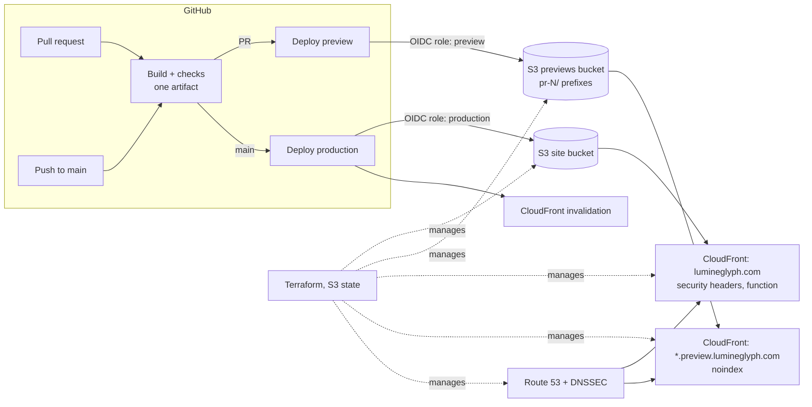

# Lumineglyph rebuild: tutorial

This folder is a step-by-step tutorial for rebuilding the Lumineglyph site. The current site is plain HTML/CSS/JS. The rebuild uses Astro for the site, AWS (S3 + CloudFront) for hosting, Terraform for infrastructure, and GitHub Actions for CI/CD. Matthew does the work himself, and Claude Code guides and checks it.

The tutorial is also the handoff document. A fresh Claude Code session that reads this file, [PROGRESS.md](PROGRESS.md) and the current step file should be able to pick up where the last session stopped.

## Goals

1. **Engineering portfolio.** The repo should show judgment: a small stack that suits the job, infrastructure as code, a real deploy pipeline, and written-down decisions.
2. **Speed and quality.** Pages are generated at build time, images optimized, fonts self-hosted, and English is a real page that search engines can read. The site meets accessibility standard WCAG 2.2 AA in both themes.
3. **Security.** Strict security headers, no long-lived AWS keys, least-privilege IAM, hardened DNS.
4. **DevOps.** Terraform with remote state, OIDC from GitHub to AWS, build once and deploy the same artifact, a preview site per pull request, and dependency automation.

**Not a goal: changing the design.** Moena designed the look and feel. The rebuilt site must look and behave the same, apart from the intentional changes listed in [01-astro-port.md](01-astro-port.md).

**Time budget: about 3–5 focused days in total.** Keep it small. If a step starts growing, simplify it or move it to the stretch list in step 09.

## Target architecture



Repo layout when finished:

```
site/                 Astro project (Moena edits site/src/content/ and site/src/i18n/)
infra/bootstrap/      Terraform: state bucket (applied once by hand)
infra/main/           Terraform: domain, DNS, certificate, buckets, CloudFront, IAM/OIDC
.github/workflows/    pipeline.yml (build → preview/prod), preview-cleanup.yml
.github/dependabot.yml
docs/adr/             Architecture decision records, written along the way
docs/rebuild/         This tutorial
CONTRIBUTING.md       How Moena (or anyone) edits copy and adds works, in Japanese and English
```

## Steps

| # | File | What you build | Needs domain/AWS? |
|---|------|----------------|-------------------|
| 00 | [00-prep.md](00-prep.md) | Repo home, branch strategy, AWS account security, registrar decision | AWS account |
| 01 | [01-astro-port.md](01-astro-port.md) | Astro project, content model, pages ported to match the current site | No |
| 02 | [02-performance-seo.md](02-performance-seo.md) | Images, fonts, SEO metadata, CSP meta tags | No |
| 03 | [03-ci.md](03-ci.md) | CI checks, Dependabot, branch protection | No |
| 04 | [04-aws-foundation.md](04-aws-foundation.md) | Terraform state bucket, domain, hosted zone, certificate | Yes |
| 05 | [05-hosting.md](05-hosting.md) | S3 + CloudFront + function + security headers, first manual deploy | Yes |
| 06 | [06-deploy-pipeline.md](06-deploy-pipeline.md) | GitHub OIDC, deploy role, automatic production deploys | Yes |
| 07 | [07-previews.md](07-previews.md) | Preview site per pull request, Moena's editing guide | Yes |
| 08 | [08-hardening.md](08-hardening.md) | DNS records (CAA, anti-spoofing), DNSSEC, alarms, scanners | Yes |
| 09 | [09-portfolio.md](09-portfolio.md) | README, ADRs, scores, CLAUDE.md rewrite, stretch goals | No |

Each step file uses the same sections: **Goal**, **Why it matters**, **Steps**, **Checkpoint**, **Commit**, and sometimes **ADR** and **Notes for Claude**.

## How Matthew and Claude work through this

1. Matthew opens the current step and does the work: writing the code, running the commands.
2. At each **Checkpoint**, Matthew asks Claude to check it (for example "check step 01, checkpoint B").
3. Claude verifies by running the read-only commands, reading the code and reviewing it. Claude then reports pass or fail with evidence, plus review notes.
4. When a checkpoint passes, Claude updates [PROGRESS.md](PROGRESS.md): status, values filled in, decisions, and deviations.

The code snippets in the step files are partial on purpose. They cover the tricky or security-sensitive parts. Matthew writes the rest, which is the point for the portfolio. Claude can expand any snippet on request.

---

## For Claude: read this before helping

**Your role is tutor and reviewer.** Matthew writes the code. Explain, check, debug and review, but don't create or edit files under `site/`, `infra/` or `.github/`, or the root `README.md` / `CONTRIBUTING.md`, unless he explicitly asks you to write that specific piece. You may update `docs/rebuild/PROGRESS.md` yourself. You may also fix mistakes in the tutorial files, but tell him what you changed and why.

**When resuming in a new session:**
1. Read this file, then [PROGRESS.md](PROGRESS.md), then the step file PROGRESS marks as current.
2. Run `git status`, `git log --oneline -20`, and look at the files the current step touches.
3. Compare PROGRESS with what is actually in the repo. If they disagree, trust the repo and say so.
4. Give Matthew a 3–5 line summary of where things stand and the next action, then ask how he wants to continue.

**Checking a checkpoint:**
- Run the checkpoint's commands yourself (builds, `curl -I`, `dig`, `terraform plan`, `astro check`) rather than taking it on trust.
- Review the code for correctness, security and idiom, matching the surrounding code. Suggest fixes and explain them. Don't rewrite his code unless he asks.
- When it passes, update PROGRESS.md: tick the step, record any values (bucket names, distribution IDs, and so on), and log any decisions or deviations.

**Never do these without Matthew's explicit go-ahead in the current conversation:**
- `terraform apply` or `destroy`
- `aws` commands that create, change or delete anything
- buying a domain, or enabling/disabling DNSSEC
- `git push`, merging PRs, or changing GitHub repo/org settings
- making the repo public

Earlier approval doesn't carry over to a new action. `terraform plan`, read-only `aws` commands (`describe`, `get`, `list`), `dig` and `curl` are fine.

**Version caution.** The tutorial was checked against these versions on 2026-11-13: Astro 7.4, @astrojs/check 0.9 (needs TypeScript 5 or 6, not 7), Terraform 1.17, AWS provider 6.73, actions/checkout v7, setup-node v7, configure-aws-credentials v6, upload-artifact v7, download-artifact v8, lychee-action v2.9, Node 24.
- Astro 7 is probably newer than your training data. When something about Astro fails or looks unfamiliar, fetch the current docs at docs.astro.build before guessing.
- Lines marked **(verify)** are the least certain. Check them against current docs when Matthew reaches them.

**Conventions:**
- Code comments are in English. The original repo's comments are Japanese because Moena's Claude Code wrote it; Matthew reads mostly English.
- Site copy stays bilingual (ja/en). Don't change Japanese copy without Moena.
- The visual design must not change, except for the accessibility fixes listed in step 02 E, whose look Moena decides.
- Prefer the industry-standard, accessible way of doing things. Matthew asked for that explicitly.

**Context.**
- Matthew Ged Miner is the full-stack engineer on the site's team page.
- Moena Miner is the bilingual designer/director. She will edit copy and works through pull requests, so keep her workflow simple.
- The repo will be public, so nothing secret goes in it.
